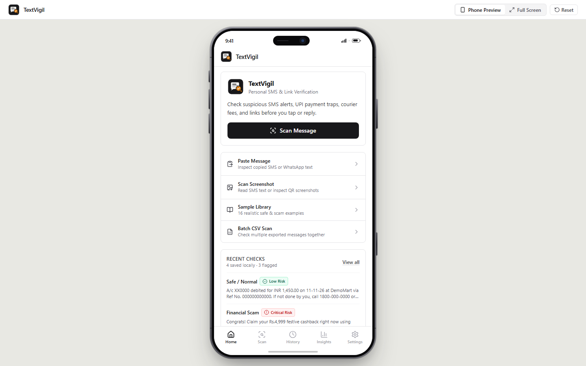
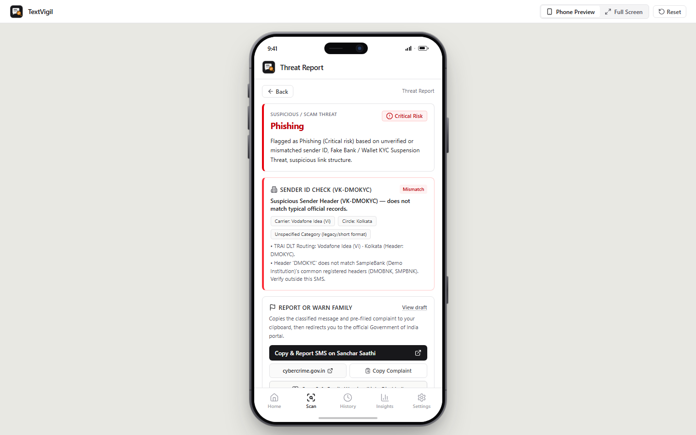
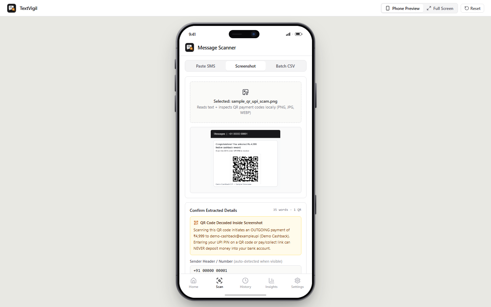
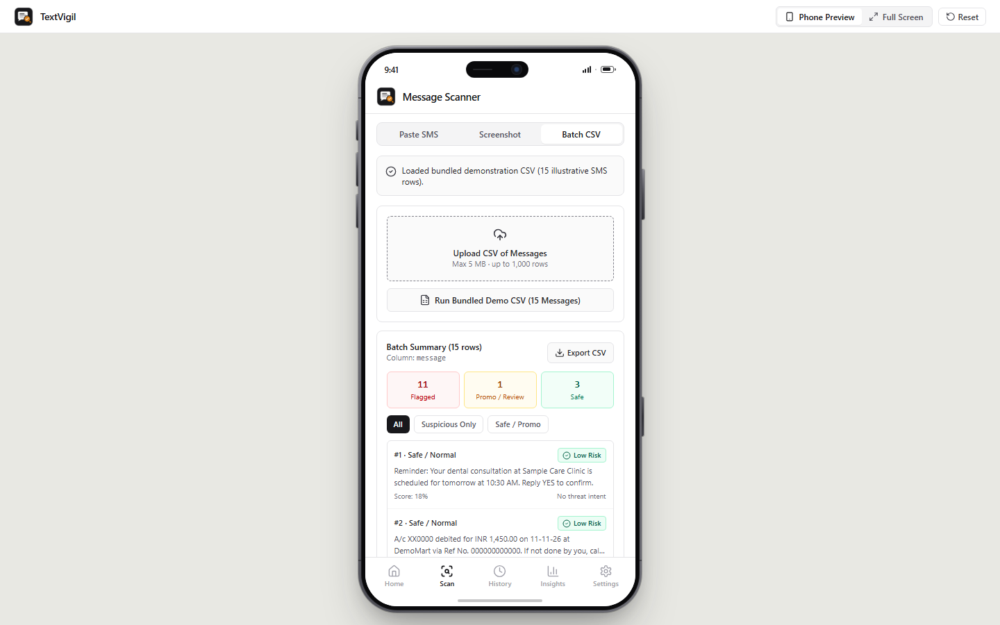
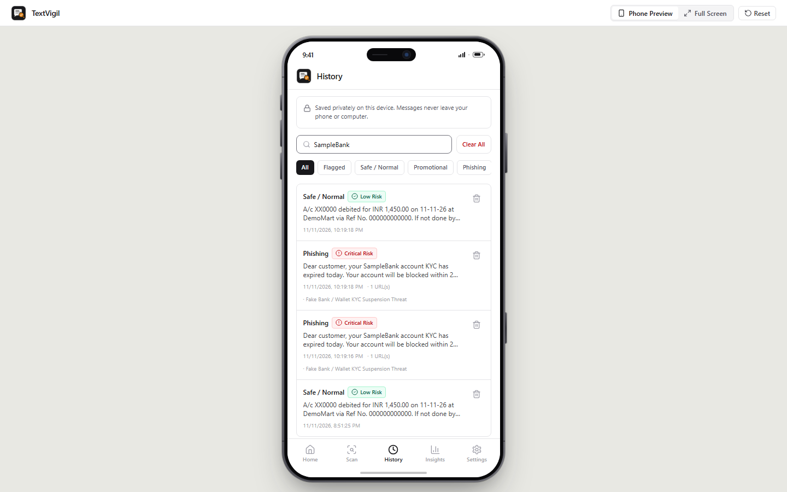
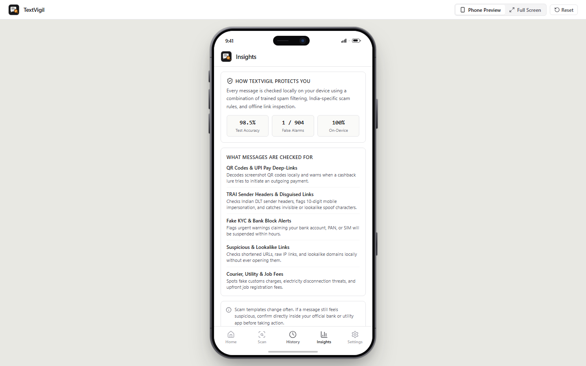
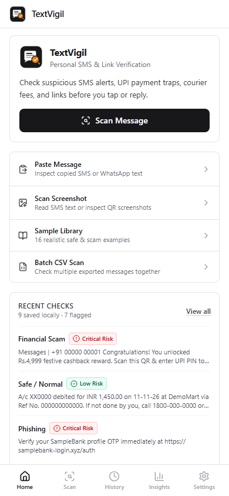
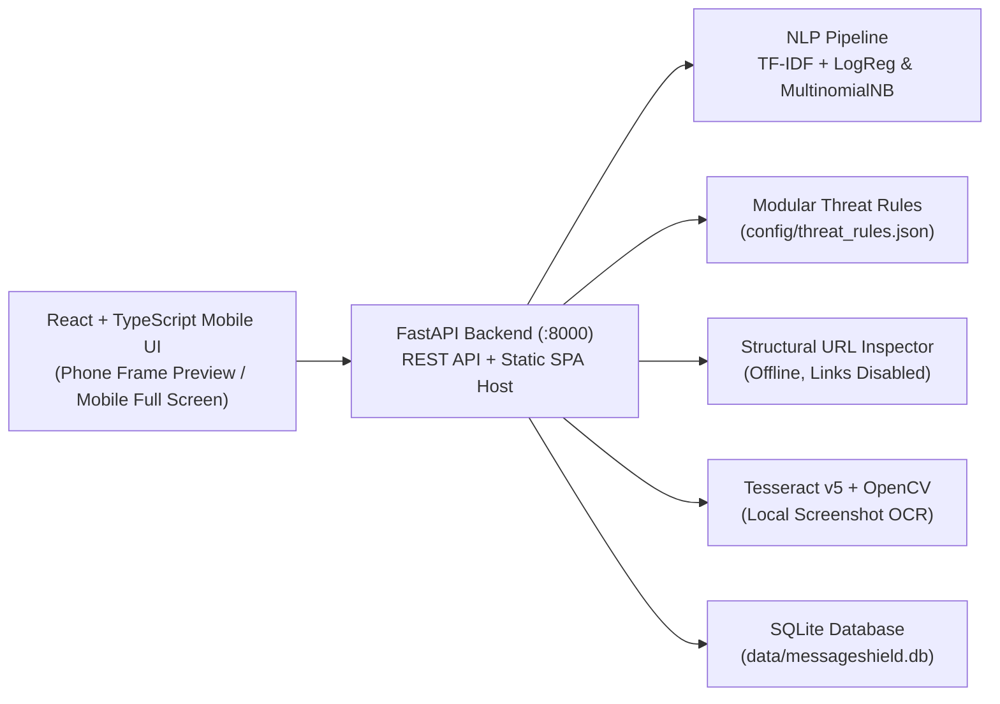

# TextVigil — Explainable Message Verification & Personal Safety Assistant

> **Day 18 — 90 Days – 90 Projects Challenge** (`90-days-90-projects-day-18-messageshield`)  
> A privacy-first, mobile-first personal safety application built with **React, TypeScript, Tailwind CSS, FastAPI, scikit-learn, and Tesseract OCR** to help everyday smartphone users verify suspicious SMS messages, Indian UPI/KYC/courier/job scams, manipulative intents, and dangerous links before acting—with clear explanations and one-tap government portal reporting.

---

## 1. Short Description & Motivation

Smartphone users in India and worldwide face daily phishing SMS alerts, fake bank KYC suspension threats, UPI collect-request traps, electricity disconnection extortion, fake courier customs fees, and OTP harvesting attempts. Standard spam filters output a bare `Spam` or `Ham` prediction without explaining *why* a message is risky, *which phrase or link* is suspicious, or *what action* to take safely.

**TextVigil** solves this with an uncluttered, plain-English mobile interface running locally on your device inside a realistic **iPhone 18 Pro** preview shell on desktop, hiding complex ML jargon by default for everyday users while keeping full metrics expandable for reviewers, and letting users copy and report classified scams directly to Government of India portals.

---

## 2. Objectives & Intended Users

- **Intended Users:** Everyday smartphone users (especially in India receiving banking, UPI, utility, courier, subsidy, and job SMS messages), students, and digital safety educators.
- **Core Questions Answered:**
  1. Is this message safe, promotional, spam, or a targeted scam/phishing attempt?
  2. Is someone attempting to steal money, UPI PINs, OTPs, or credentials?
  3. Does the message contain a shortened, raw-IP, or brand-lookalike URL?
  4. Which exact phrases and model tokens triggered the alert?
  5. What safe steps should I take next?

---

## 3. Key Features

- **Simple Everyday Mobile UI & iPhone 18 Pro Preview:**
  - Centered Figma-style **iPhone 18 Pro** titanium hardware frame (`390 × 844` display scale, brushed titanium rim, compact Dynamic Island, side keys) with minimal **Phone Preview**, **Full Screen**, and **Reset** controls—free of status badge clutter.
  - Automatically renders bezel-free on mobile browsers (`< 768px`) with crisp paper-and-ink typography, clean 1px borders, plain-language reports (with complex ML matrices/token weights tucked cleanly into collapsed technical disclosures), and 5-tab bottom navigation (**Home**, **Scan**, **History**, **Insights**, **Settings**).
- **Direct Government Portal Reporting (`sancharsaathi.gov.in` & `cybercrime.gov.in`):**
  - On any classified threat or flagged SMS report, users can tap **Copy & Report SMS on Sanchar Saathi** (Chakshu) or **cybercrime.gov.in** to copy the exact classified message and pre-filled complaint draft to the clipboard and redirect directly to the official portal.
- **Three-Mode Message Scanner:**
  - **Paste SMS:** Clipboard paste, clear, character counter (`2,000` max), input validation, and illustrative sample chips.
  - **Screenshot OCR:** Upload `.png/.jpg/.jpeg/.webp/.bmp/.tiff` -> local OpenCV preprocessing + Tesseract v5 extraction -> **editable text box** -> mandatory user confirmation before analysis; fails honestly on unreadable/blank images and never auto-opens embedded links.
  - **Batch CSV Scan:** Validates `.csv` uploads (max `5 MB` / `1,000` rows), suggests the message column, classifies in bulk, filters suspicious rows, and exports a **CSV-formula-injection-sanitized** report.
- **Reproducible NLP Pipeline (Zero Data Leakage):**
  - Trains **Logistic Regression** and **Multinomial Naive Bayes** over scam-aware TF-IDF unigrams/bigrams on deduplicated UCI SMS Spam Collection splits (`4,128` train / `1,032` stratified held-out test).
  - Surfaces uncalibrated score disclaimers and per-message TF-IDF token contributions.
- **8-Category Threat Classification + `Needs Review`:**
  - `Safe / Normal`, `Promotional`, `General Spam`, `Financial Scam`, `Phishing`, `Fake Reward`, `Impersonation`, `OTP / Credential Theft`, and `Needs Review`.
  - Clearly distinguishes whether classification came from the ML baseline, transparent India rules, or defensive context guards.
- **10 Scam Intent Detectors & Modular India Scam Rules (`config/threat_rules.json`):**
  - Covers UPI collect-request manipulation, fake bank/PAN KYC blocks, electricity disconnection threats, courier redelivery fees, job registration fees, government subsidy impersonation, fake loans/investments, OTP/AnyDesk theft, and defensive context guards so legitimate bank debit alerts (`"Never share OTP"`) do not false-positive.
- **Offline Structural URL & Unicode Spoof Auditor:**
  - Extracts URLs safely (never rendered as clickable links and never fetched automatically) and inspects shorteners, raw IP hosts, high-abuse TLDs, brand lookalikes (e.g., `samplebank-kyc.xyz`), punycode (`xn--`), `@` userinfo redirects (`https://samplebank.example@demo-redirect.xyz`), zero-width evasion characters inside words (`O\u200bT\u200bP`), and mixed-script Cyrillic/Greek homoglyphs (`\u0455amplebank-secure.xyz`).
- **Screenshot QR & `upi://pay` Payment Forensics (Zero-Network):**
  - Uses local OpenCV (`cv2.QRCodeDetector`) + deep-link parsing on screenshots and pasted `upi://pay` links to expose the exact payee VPA (`pa`), amount (`am`), personal handle status, and lure contradictions before any payment app opens (`"Scanning this QR initiates an OUTGOING payment — QR codes never deposit money"`).
- **Indian TRAI DLT Sender-Header Decoder & Verify Without Links Card:**
  - Decodes `<Operator><Circle>-<Header>-<S/T/P/G>` DLT headers, flags 10-digit personal mobile numbers impersonating banks/DISCOMs/government bodies, and displays offline official helplines (`sbi.co.in` · `1800 1234`, `1912`, `1930`, etc.) so users never rely on SMS links.
- **One-Tap Defanged "Warn Family" Summary Card:**
  - Copies a clear 4-line safety alert with all risky URLs and VPAs automatically neutralized (`hxxp://` and `[.]` / `[at]`) so relatives can read the warning without accidentally tapping the phishing link.
- **"Already Clicked or Paid?" Golden-Hour Recovery Triage:**
  - Tailored post-incident triage drawer (Airplane Mode / uninstall guidance for AnyDesk RATs vs 1930 + UTR freeze checklist for UPI fraud) with pre-extracted suspect domains/VPAs/phones ready for `cybercrime.gov.in`.
- **Local Cross-Message Campaign & Domain-Rotation Matcher:**
  - Compares incoming suspicious messages against locally saved SQLite scan history to surface rotating-domain phishing campaigns, repeated callback numbers, and reused payee VPAs without external tracking.
- **Private Local History & Model Insights:**
  - SQLite-backed search, category filtering, individual deletion, and clear-all controls.
  - Dedicated **Insights** screen with real held-out test metrics, Confusion Matrix, class-imbalance breakdown, top n-grams, and an interactive **Threshold Explorer**.

---

## 4. Portfolio Screenshots

| Desktop Phone Frame (`Home`) | Explainable Threat Report | Screenshot OCR Confirmation |
| :---: | :---: | :---: |
|  |  |  |

| Batch CSV Scanner | Local SQLite History | Model Insights & Comparison | Mobile Viewport (`390×844`) |
| :---: | :---: | :---: | :---: |
|  |  |  |  |

---

## 5. Architecture Overview



See [docs/ARCHITECTURE.md](docs/ARCHITECTURE.md) for API endpoint tables and database schema details.

---

## 6. Technology Stack

- **Frontend:** React 19, TypeScript, Tailwind CSS v4, Vite, Lucide React
- **Backend:** Python 3.12, FastAPI, Uvicorn, Pydantic v2
- **Machine Learning & NLP:** scikit-learn, pandas, NumPy, joblib (TF-IDF, Logistic Regression, Multinomial Naive Bayes)
- **OCR & Image Processing:** Tesseract OCR v5 (`pytesseract`), OpenCV (`opencv-python-headless`), Pillow
- **Storage:** SQLite3 (local analysis history and settings)
- **Testing:** Pytest, Pytest-Cov, FastAPI TestClient, TypeScript `tsc`, headless Chrome E2E verification

---

## 7. Project Directory Structure

```text
90-days-90-projects-day-18-messageshield/
├── config/
│   └── threat_rules.json           # Modular India scam rules, intents, highlight phrases, URL targets
├── data/
│   ├── README.md                   # UCI dataset documentation & sample asset manifest
│   ├── raw/                        # Downloaded UCI SMSSpamCollection dataset
│   ├── sample_batch_messages.csv   # Bundled 15-row demo CSV (incl. sender headers & forensic traps)
│   └── sample_screenshots/         # Bundled SMS & QR screenshots + blank test image
├── docs/
│   ├── ARCHITECTURE.md
│   ├── DEVELOPMENT_NOTES.md
│   ├── PROJECT_OVERVIEW.md
│   ├── TESTING.md
│   ├── TROUBLESHOOTING.md
│   └── USER_GUIDE.md
├── frontend/
│   ├── src/
│   │   ├── api/client.ts
│   │   ├── components/             # PhoneFrameShell, BottomNav, RiskBadge, HighlightedMessage, ConfusionMatrix
│   │   ├── data/examples.ts        # 16 labeled demonstration examples + safety tips
│   │   ├── screens/                # Home, Scanner, AnalysisResult, History, Insights, Examples, Settings
│   │   └── types/messageshield.ts
│   ├── package.json
│   └── vite.config.ts
├── models/
│   ├── messageshield_models.joblib # Saved trained TF-IDF + LR & MNB pipelines
│   └── evaluation_report.json      # Real held-out test metrics & threshold curve
├── screenshots/                    # Verified desktop phone-frame & mobile browser screenshots
├── scripts/
│   ├── download_dataset.py         # Downloads & verifies UCI SMS Spam Collection
│   ├── train_models.py             # Reproducible training & evaluation CLI
│   └── generate_demo_assets.py     # Generates sample CSV & SMS/QR test screenshots
├── src/
│   ├── config.py
│   ├── main.py                     # FastAPI routes + static SPA host
│   ├── schemas.py
│   ├── ml/                         # data_loader, preprocessing, model_training, model_evaluation, prediction
│   └── core/                       # threat_rules, url_inspector, unicode_audit, upi_dissector, sender_analyzer, campaign_matcher, explanation, recommendations, ocr_processor, history, batch_analysis
├── tests/                          # 30 automated tests across ML, forensics, false positives, OCR, QR, batch, SQLite, API
├── .env.example
├── .gitignore
├── DEMO_SCRIPT.md
├── LICENSE
├── QUICKSTART.md
├── pyproject.toml
├── requirements.txt
├── run.bat
├── setup.bat
└── test.bat
```

---

## 8. Prerequisites (Windows)

- **Python 3.10–3.12** (Python 3.12 recommended for prebuilt ML/OpenCV wheels)
- **Node.js 20+** and **npm**
- **Tesseract OCR v5** (optional, required only for Screenshot OCR; installer places binary at `C:\Program Files\Tesseract-OCR\tesseract.exe`, which TextVigil auto-detects)

---

## 9. Step-by-Step Windows Installation & Quick Start

### One-Command Windows Setup & Launch

```powershell
cd "D:\90 days\90-days-90-projects-day-18-messageshield"
.\setup.bat
.\run.bat
```

Open **http://127.0.0.1:8000** in your browser (Swagger API docs: **http://127.0.0.1:8000/docs**).

### Manual PowerShell Commands

```powershell
py -3.12 -m venv .venv
.\.venv\Scripts\Activate.ps1
python -m pip install --upgrade pip
pip install -r requirements.txt
Copy-Item .env.example .env

python scripts\download_dataset.py
python scripts\train_models.py
python scripts\generate_demo_assets.py

npm --prefix frontend install
npm --prefix frontend run build

.\.venv\Scripts\python.exe -m uvicorn src.main:app --host 127.0.0.1 --port 8000
```

---

## 10. Environment Variables (`.env.example`)

All defaults run **100% locally** with zero API keys required. Optional overrides in `.env`:

- `MS_HOST` / `MS_PORT`: Server bind host & port (`127.0.0.1` / `8000`)
- `TESSERACT_CMD`: Custom path to `tesseract.exe` if installed outside `C:\Program Files\Tesseract-OCR\`
- `MS_MAX_IMAGE_MB`, `MS_MAX_CSV_MB`, `MS_MAX_CSV_ROWS`, `MS_MAX_MESSAGE_CHARS`: Upload validation caps
- `MS_URL_REPUTATION_PROVIDER`: `local_only` (default) or `external_configured`

---

## 11. Dataset, Model Training & Measured Evaluation Results

- **Dataset:** UCI SMS Spam Collection v.1 (Almeida et al., 2011; UCI ML Repository ID 228; CC BY 4.0).
- **Deduplication & Split:** `5,574` raw rows -> `414` duplicate/conflicting rows removed **prior** to stratified 80/20 split (`random_state=42`) -> `4,128` train / `1,032` held-out test (`4,518` Ham / `642` Spam overall).
- **Measured Held-Out Test Results (`1,032` unseen messages at 50% threshold):**

| Model | Accuracy | Precision | Recall | F1-Score | ROC-AUC | TN / FP / FN / TP |
| --- | :---: | :---: | :---: | :---: | :---: | :---: |
| **Multinomial Naive Bayes (TF-IDF)** *(Default)* | **98.45%** | **99.12%** | **88.28%** | **93.39%** | 98.75% | `903 / 1 / 15 / 113` |
| **Logistic Regression (TF-IDF)** | 98.35% | **99.12%** | 87.50% | 92.95% | **99.76%** | `903 / 1 / 16 / 112` |

> **Honesty Note:** Raw TF-IDF probabilities reflect statistical similarity to the 2011 UCI SMS corpus and are **not** calibrated real-world fraud probabilities. Indian-specific scam categories are transparently detected via `config/threat_rules.json` and attributed separately in every report.

---

## 12. Example Inputs & Outputs

| Sample Input | Category & Risk | Primary Evidence |
| --- | --- | --- |
| `"Dear customer, your SampleBank account KYC has expired today. Your account will be blocked within 2 hours. Update KYC immediately at http://samplebank-kyc.xyz/verify"` | **Phishing** · `Critical` | Fake KYC suspension rule, urgency coercion, lookalike bank domain on `.xyz` |
| `"Congratulations! Approve the UPI collect request and enter your UPI PIN to receive Rs.4999 cashback."` | **Financial Scam** · `Critical` | UPI Collect / PIN manipulation rule + money transfer & reward intents |
| `"A/c XX0000 debited for INR 1,450.00 on 11-11-26 at DemoMart via Ref No. 000000000000. If not done by you, call 1800-000-0000 or block card in official SampleBank app. Never share OTP."` | **Safe / Normal** · `Low` | Benign bank transaction & defensive `"Never share OTP"` context guard |

---

## 13. Testing Instructions & Actual Test Status

```powershell
.\test.bat
```

- **Automated Backend & ML Suite (`pytest`):** **PASS — 30 / 30 tests passed** (`89%` coverage across `src/`).
- **Frontend TypeScript Check & Production Build (`tsc --noEmit && vite build`):** **PASS — 0 errors**.
- **Live Browser E2E Verification (Headless Chrome):** **PASS** across desktop phone frame (`1440×900`, `1280×768`), full-screen toggle, responsive mobile (`390×844`), paste SMS + TRAI sender check, rotated-domain campaign match, Unicode homoglyph spoof audit, QR cashback screenshot decoding (`sample_qr_upi_scam.png`), defanged (`hxxp://` / `[.]`) family warning copy, 1930 Golden Hour recovery triage, direct Government portal clipboard + redirect check, negative OCR, batch CSV, history search/clear, insights threshold slider, sample library, and settings.

See [docs/TESTING.md](docs/TESTING.md) for full details.

---

## 14. Known Limitations & Privacy Considerations

- **No Automatic Link Fetching:** Embedded URLs are inspected structurally offline and never clicked or resolved over the network by default.
- **Language & Script Scope:** Trained on English SMS (`SMSSpamCollection`) with English/Hinglish-transliterated Indian scam rules; regional-language Unicode scripts (e.g., Hindi/Tamil) are not yet modeled.
- **Not an Official Reporting Portal:** For financial cyber fraud in India, dial **1930**, report at `cybercrime.gov.in`, or report scam SMS on `sancharsaathi.gov.in`.
- **Privacy Guarantees:** Messages are processed locally, saved only in local SQLite (`data/messageshield.db`, deletable anytime), and never logged to stdout.

---

## 15. Future Enhancements

- Multilingual transliteration & regional Indian script threat rules (Hindi, Tamil, Telugu, Marathi).
- Optional calibrated probability layer (Platt / Isotonic calibration) on a multi-class Indian SMS corpus.
- PWA service-worker packaging for installable offline mobile testing.

---

## 16. License & Attribution

Released under the [MIT License](LICENSE).  
UCI SMS Spam Collection dataset attributed to Almeida, T.A., Gómez Hidalgo, J.M., & Yamakami, A. (2011).
