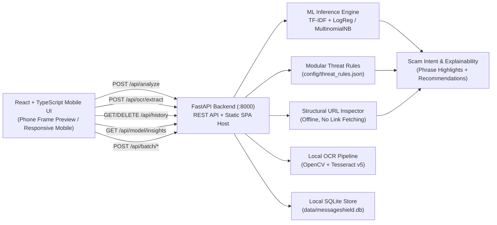

# Architecture — TextVigil

## System Architecture

## Key API Endpoints

| Endpoint | Method | Purpose |
| --- | --- | --- |
| `/api/health` | `GET` | Runtime diagnostics (model loaded, Tesseract OCR version, history count) |
| `/api/analyze` | `POST` | Hybrid ML + Rule + URL + Unicode + UPI/QR + TRAI Sender + Local Campaign Match analysis |
| `/api/ocr/extract` | `POST` | Validates image upload, extracts editable text via Tesseract OCR, detects sender header, and decodes QR/UPI payloads via OpenCV |
| `/api/history` | `GET` | Lists locally saved scans with optional `search` and `category` filters |
| `/api/history/{id}` | `DELETE` | Deletes a single saved record |
| `/api/history` | `DELETE` | Clears all saved analysis history |
| `/api/model/insights` | `GET` | Serves held-out UCI test evaluation metrics, confusion matrix, and threshold curve |
| `/api/batch/inspect` | `POST` | Validates CSV upload and returns columns + suggested text column |
| `/api/batch/analyze` | `POST` | Classifies CSV rows safely without executing formulas or scripts |
| `/api/batch/demo` | `POST` | Runs batch analysis on bundled `data/sample_batch_messages.csv` |
| `/api/batch/export` | `POST` | Returns formula-injection-sanitized CSV report |
| `/api/settings` | `GET` / `PUT` | Reads or updates model, threshold, appearance, and history settings |

## Local SQLite Schema (`data/messageshield.db`)

- `analysis_history`: `id`, `timestamp`, `message`, `source`, `classification`, `threat_category`, `risk_level`, `risk_score`, `model_name`, `raw_spam_score`, `threshold_used`, `warning_signs_json`, `url_indicators_json`, `detected_intents_json`, `recommended_actions_json`, `full_result_json`.
- `app_settings`: key-value JSON pairs for `active_model`, `classification_threshold`, `url_reputation_mode`, `save_history_enabled`, and `appearance_mode`.
